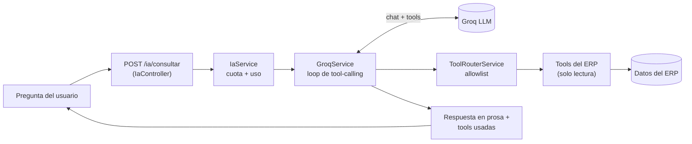

# LLM Stock: Reportes y Consultas en Lenguaje Natural para un ERP

**El módulo de reportes/consultas con IA de un ERP en producción. Un usuario de negocio pregunta en lenguaje natural — "¿Cuánto vendí esta semana?", "¿Qué productos tengo que reponer?", "¿Cuánto le debo al proveedor Dicaro?" — y un modelo de lenguaje (LLM) le responde ejecutando tools de solo lectura sobre los datos del propio ERP, nunca generando SQL ni inventando números. Este repositorio muestra el código real del módulo e incluye un demo autocontenido y Dockerizado que se corre con un solo comando.**

<p align="right"><a href="README.md">English</a> · <strong>Español</strong></p>

> Esta es una vitrina pública de un módulo extraído del monorepo privado del ERP de **Nuvaryn SA**. El código de producción en [`src/ia`](src/ia) se muestra verbatim; el demo ejecutable en [`src/demo`](src/demo) reemplaza la base de datos del ERP por un fixture en memoria para que el módulo corra en cualquier lado (ver [Qué es real y qué está mockeado](#qué-es-real-y-qué-está-mockeado)).

---

## Demo

Necesitás [Docker](https://docs.docker.com/get-docker/) y una **API key gratuita de Groq** ([conseguila acá](https://console.groq.com/keys)).

```bash
# 1. Configurá tu key
cp .env.example .env
#    luego editá .env y poné GROQ_API_KEY=gsk_...

# 2. Build y run
docker compose up --build

# 3. Abrí la UI
#    http://localhost:3000
```

Escribí una pregunta (o tocá una de las sugerencias) y vas a ver:

- la **respuesta en lenguaje natural** que generó el modelo,
- las **tools** que decidió ejecutar y los **datos estructurados** que devolvió cada una,
- el **modelo, la cantidad de tokens y las iteraciones** de esa consulta.

Probá, por ejemplo: *"¿Cuánto vendí esta semana?"*, *"¿Qué clientes tienen deuda pendiente?"*, *"¿Qué productos tengo que reponer urgente?"*

---

## Características principales

- **Preguntas en lenguaje natural, respuestas ancladas en los datos.** El modelo solo responde con datos que devuelven las tools; tiene instrucción explícita de nunca calcular ni asumir un número que una tool no haya entregado.
- **Allowlist de tools de solo lectura.** Once tools del ERP cubren ventas, compras, stock, reposición, clientes, estado de cuenta, proveedores, margen, caja, tesorería y listas de precio. Lo que no está en la allowlist no existe para el modelo.
- **Resultados auditables.** Cada respuesta incluye las tools ejecutadas, sus argumentos y sus resultados crudos, para que el usuario pueda rastrear de dónde salió cada número.
- **Contrato de presentación estructurado.** Cada tool devuelve métricas, columnas y filas junto a sus datos de dominio, así el frontend renderiza un panel rico mientras el modelo mantiene la prosa breve.
- **Resiliente por diseño.** Loop de tool-calling acotado (máx 3 iteraciones), fallback por modelo ante rate limits, timeouts duros y errores tipados (429 / 503) — no excepciones crudas de la SDK.
- **Consciente del costo.** El consumo de tokens se acumula en todo el loop, con cuotas por usuario y globales en el módulo de producción.

---

## Puntos técnicos destacados

### 1 · Un loop de tool-calling acotado

El corazón del módulo ([`src/ia/groq/groq.service.ts`](src/ia/groq/groq.service.ts)) envía el catálogo de tools del ERP al modelo y corre un loop estricto: si el modelo pide tools, se ejecutan a través de una allowlist y los resultados se le devuelven; el loop termina cuando el modelo responde en prosa o se agotan las iteraciones. Nunca genera SQL ni toca la base directamente.

```typescript
for (let iteracion = 1; iteracion <= MAX_ITERACIONES; iteracion++) {
  const { completion, indiceModelo } = await this.llamarGroq(messages, indiceModeloActual);
  const mensaje = completion.choices[0].message;
  messages.push(mensaje);

  if (!mensaje.tool_calls?.length) {
    return { respuesta: mensaje.content ?? '', consultasUtilizadas, /* …tokens, iteraciones */ };
  }

  const resultados = await Promise.all(
    mensaje.tool_calls.map(async (toolCall) => {
      const argumentos = this.parsearArgumentos(toolCall.function.arguments);
      const resultado = await this.toolRouter.ejecutar(toolCall.function.name, argumentos);
      return { toolCall, argumentos, resultado };
    }),
  );
  // se devuelve cada resultado al modelo como mensaje `role: 'tool'`…
}
```

### 2 · Una allowlist explícita, no "lo que el modelo pida"

El modelo solo puede alcanzar lo que el router ([`src/ia/tools/tool-router.service.ts`](src/ia/tools/tool-router.service.ts)) mapea por nombre. Este es el límite de seguridad real — las definiciones de tools que se le mandan al modelo son solo *lo que puede pedir*.

```typescript
async ejecutar(nombre: string, args: unknown): Promise<unknown> {
  switch (nombre) {
    case 'consultarVentas':   return this.ventas.ejecutar(args as /* … */);
    case 'consultarStock':    return this.stock.ejecutar(args as /* … */);
    case 'reposicionStock':   return this.reposicionStock.ejecutar(args as /* … */);
    // …11 tools en total
    default:
      throw new BadRequestException(`Tool no permitida: ${nombre}`);
  }
}
```

### 3 · Definiciones de tools que sobreviven a un validador de JSON-schema server-side

Todo parámetro opcional se tipa `['string', 'null']` porque el modelo suele mandar un `null` explícito en vez de omitir la clave; con un `'string'` a secas la request se rechazaría antes de llegar al servicio ([`src/ia/tools/erp-tools.ts`](src/ia/tools/erp-tools.ts)).

```typescript
{
  name: 'consultarVentas',
  description: 'Consulta ventas realizadas en el ERP. Usar para cantidades vendidas, facturación…',
  parameters: {
    type: 'object',
    properties: {
      desde: { type: 'string', description: 'Fecha inicial YYYY-MM-DD' },
      hasta: { type: 'string', description: 'Fecha final YYYY-MM-DD' },
      tipoCliente: { type: ['string', 'null'], enum: ['CF', 'EMPRESA', 'PERSONA_FISICA', null] },
      modo: { type: ['string', 'null'], enum: ['resumen', 'rankingProductos', 'comparativa', /* … */ null] },
    },
    required: ['desde', 'hasta'],
    additionalProperties: false,
  },
}
```

### 4 · Un contrato de presentación compartido por todas las tools

Las tools declaran *qué mostrar* — métricas, columnas, filas y metadata — y el frontend solo renderiza. Una métrica `null` se descarta en vez de convertirse en un `0` engañoso ([`src/ia/presentacion/presentacion.ts`](src/ia/presentacion/presentacion.ts)).

```typescript
export interface ResultadoPresentable {
  resumen?: string;        // el dato que la prosa del modelo debe destacar primero
  metricas: Metrica[];
  columnas: Columna[];
  filas: Fila[];
  metadata: MetadataResultado; // { totalResultados, resultadosMostrados, truncado }
}
```

### 5 · Degradación elegante ante el rate limit del tier gratuito

Un `429` de un modelo avanza al siguiente de la lista de fallback; solo cuando se agotan todos propaga un único `GroqRateLimitError` tipado — nunca una excepción cruda de la SDK ([`src/ia/groq/groq-errors.ts`](src/ia/groq/groq-errors.ts)).

---

## Arquitectura



En producción, los **datos del ERP** son PostgreSQL vía Prisma. En este demo, son el fixture en memoria de [`src/demo/mock-erp.ts`](src/demo/mock-erp.ts); todo lo demás corre la lógica real.

---

## Estructura del proyecto

```
src/
├─ ia/                      ← módulo de producción (verbatim, vitrina de solo lectura)
│  ├─ groq/groq.service.ts  ← el loop de tool-calling
│  ├─ tools/                ← 11 tools de solo lectura + router allowlist
│  ├─ presentacion/         ← el contrato de presentación métricas/columnas/filas
│  ├─ quota/ · usage/       ← cuotas por usuario y globales, conteo de tokens
│  ├─ dto/ · guards/        ← validación de request, guard de rate limit
│  └─ ia.controller.ts      ← POST /ia/consultar (NestJS)
└─ demo/                    ← demo ejecutable y autocontenido
   ├─ groq-loop.ts          ← copia fiel del loop, desacoplada de Prisma/NestJS
   ├─ mock-erp.ts           ← fixture del ERP en memoria + router mock
   ├─ server.ts             ← servidor Express que expone POST /ia/consultar
   └─ public/index.html     ← UI web mínima
```

---

## Qué es real y qué está mockeado

| Capa | Demo |
|---|---|
| Loop de tool-calling, system prompt, fallback de modelos, manejo de rate limit | Lógica **real** (copia fiel de `src/ia/groq/groq.service.ts`) |
| Definiciones de tools que se le mandan al modelo (`ERP_TOOLS`) | **Real**, importadas verbatim desde `src/ia` |
| Contrato de presentación y errores tipados | **Real**, importados verbatim desde `src/ia` |
| Datos del ERP detrás de las tools | **Mockeados** — un fixture chico en memoria de una distribuidora de lácteos (sin base de datos) |
| Transporte | Express (demo) en lugar del controller completo NestJS, Prisma, auth JWT y persistencia de cuotas |

El módulo de producción es una feature de NestJS respaldada por PostgreSQL/Prisma; no puede publicarse con una base de datos privada de la empresa, así que el demo reemplaza solo esa capa de datos.

---

## Correr localmente (sin Docker)

Requiere Node.js 20+.

```bash
npm install
cp .env.example .env   # poné GROQ_API_KEY
npm run dev            # http://localhost:3000
```

---

## Stack técnico

TypeScript · Groq SDK (tool-calling con LLM) · Express (demo) · NestJS + Prisma + PostgreSQL (módulo de producción) · Docker.

<sub>© Nuvaryn SA — vitrina interna. Los datos del demo son ficticios.</sub>
