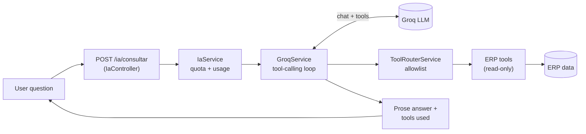

# LLM Stock: Natural-Language Reports & Queries for an ERP

**The AI reports/queries module of a production ERP. A business user asks a question in plain language — "How much did I sell this week?", "Which products do I need to restock?", "How much do I owe supplier Dicaro?" — and a Large Language Model answers it by calling read-only tools over the ERP's own data, never by writing SQL or inventing numbers. This repository showcases that module's real source code and ships a self-contained, Dockerized demo you can run in one command.**

<p align="right"><strong>English</strong> · <a href="README.es.md">Español</a></p>

> This is a public showcase of one module extracted from the private ERP monorepo of **Nuvaryn SA**. The production code under [`src/ia`](src/ia) is shown verbatim; the runnable demo under [`src/demo`](src/demo) swaps the ERP database for an in-memory fixture so the module can run anywhere (see [What is real vs. mocked](#what-is-real-vs-mocked)).

---

## Demo

You need [Docker](https://docs.docker.com/get-docker/) and a free **Groq API key** ([get one here](https://console.groq.com/keys)).

```bash
# 1. Configure your key
cp .env.example .env
#    then edit .env and set GROQ_API_KEY=gsk_...

# 2. Build and run
docker compose up --build

# 3. Open the UI
#    http://localhost:3000
```

Type a question (or click one of the suggestions) and you will see:

- the **plain-language answer** the model produced,
- the **tool calls** it decided to make and the **structured data** each returned,
- the **model, token count and number of iterations** for that query.

Ask, for example: *"¿Cuánto vendí esta semana?"*, *"¿Qué clientes tienen deuda pendiente?"*, *"¿Qué productos tengo que reponer urgente?"*

---

## Key Features

- **Natural-language questions, grounded answers.** The model only answers from data returned by tools; it is instructed never to calculate or assume a number a tool did not provide.
- **Read-only tool allowlist.** Eleven ERP tools cover sales, purchases, stock, restocking, customers, account statements, suppliers, margin, cash, treasury and price lists. Anything not in the allowlist does not exist for the model.
- **Auditable results.** Every answer carries the exact tools called, their arguments and their raw results, so a user can trace where each figure came from.
- **Structured presentation contract.** Each tool returns metrics, columns and rows alongside its domain data, so a frontend can render a rich panel while the model keeps its prose short.
- **Resilient by design.** A bounded tool-calling loop (max 3 iterations), per-model fallback on rate limits, hard request timeouts and typed errors (429 / 503) — not raw SDK exceptions.
- **Cost-aware.** Token usage is accumulated across the whole loop, with per-user and global quotas in the production module.

---

## Key Technical Highlights

### 1 · A bounded tool-calling loop

The heart of the module ([`src/ia/groq/groq.service.ts`](src/ia/groq/groq.service.ts)) sends the catalog of ERP tools to the model and runs a strict loop: if the model asks for tools, they are executed through an allowlist and the results are fed back; the loop ends when the model answers in prose or when it runs out of iterations. It never generates SQL and never touches the database directly.

```typescript
for (let iteracion = 1; iteracion <= MAX_ITERACIONES; iteracion++) {
  const { completion, indiceModelo } = await this.llamarGroq(messages, indiceModeloActual);
  const mensaje = completion.choices[0].message;
  messages.push(mensaje);

  if (!mensaje.tool_calls?.length) {
    return { respuesta: mensaje.content ?? '', consultasUtilizadas, /* …tokens, iteraciones */ };
  }

  const resultados = await Promise.all(
    mensaje.tool_calls.map(async (toolCall) => {
      const argumentos = this.parsearArgumentos(toolCall.function.arguments);
      const resultado = await this.toolRouter.ejecutar(toolCall.function.name, argumentos);
      return { toolCall, argumentos, resultado };
    }),
  );
  // feed each tool result back to the model as a `role: 'tool'` message…
}
```

### 2 · An explicit allowlist, not "whatever the model asks for"

The model can only ever reach what the router ([`src/ia/tools/tool-router.service.ts`](src/ia/tools/tool-router.service.ts)) maps by name. This is the real security boundary — the tool definitions sent to the model are just *what it may ask for*.

```typescript
async ejecutar(nombre: string, args: unknown): Promise<unknown> {
  switch (nombre) {
    case 'consultarVentas':   return this.ventas.ejecutar(args as /* … */);
    case 'consultarStock':    return this.stock.ejecutar(args as /* … */);
    case 'reposicionStock':   return this.reposicionStock.ejecutar(args as /* … */);
    // …11 tools total
    default:
      throw new BadRequestException(`Tool no permitida: ${nombre}`);
  }
}
```

### 3 · Tool definitions that survive a server-side JSON-schema validator

Every optional parameter is typed `['string', 'null']` because the model often sends an explicit `null` instead of omitting the key; with a bare `'string'` the request would be rejected before reaching the service ([`src/ia/tools/erp-tools.ts`](src/ia/tools/erp-tools.ts)).

```typescript
{
  name: 'consultarVentas',
  description: 'Consulta ventas realizadas en el ERP. Usar para cantidades vendidas, facturación…',
  parameters: {
    type: 'object',
    properties: {
      desde: { type: 'string', description: 'Fecha inicial YYYY-MM-DD' },
      hasta: { type: 'string', description: 'Fecha final YYYY-MM-DD' },
      tipoCliente: { type: ['string', 'null'], enum: ['CF', 'EMPRESA', 'PERSONA_FISICA', null] },
      modo: { type: ['string', 'null'], enum: ['resumen', 'rankingProductos', 'comparativa', /* … */ null] },
    },
    required: ['desde', 'hasta'],
    additionalProperties: false,
  },
}
```

### 4 · A presentation contract shared by every tool

Tools declare *what to show* — metrics, columns, rows and metadata — and the frontend only renders. A `null` metric is dropped rather than turned into a misleading `0` ([`src/ia/presentacion/presentacion.ts`](src/ia/presentacion/presentacion.ts)).

```typescript
export interface ResultadoPresentable {
  resumen?: string;        // the figure the model's prose should lead with
  metricas: Metrica[];
  columnas: Columna[];
  filas: Fila[];
  metadata: MetadataResultado; // { totalResultados, resultadosMostrados, truncado }
}
```

### 5 · Graceful degradation under a free-tier rate limit

A `429` from one model advances to the next in the fallback list; only when every model is exhausted does a single typed `GroqRateLimitError` propagate — never a raw SDK exception ([`src/ia/groq/groq-errors.ts`](src/ia/groq/groq-errors.ts)).

---

## Architecture



In production, **ERP data** is PostgreSQL through Prisma. In this demo, it is the in-memory fixture in [`src/demo/mock-erp.ts`](src/demo/mock-erp.ts); everything else runs the real logic.

---

## Project structure

```
src/
├─ ia/                      ← production module (shown verbatim, read-only showcase)
│  ├─ groq/groq.service.ts  ← the tool-calling loop
│  ├─ tools/                ← 11 read-only ERP tools + allowlist router
│  ├─ presentacion/         ← the metrics/columns/rows presentation contract
│  ├─ quota/ · usage/       ← per-user & global quotas, token accounting
│  ├─ dto/ · guards/        ← request validation, rate-limit guard
│  └─ ia.controller.ts      ← POST /ia/consultar (NestJS)
└─ demo/                    ← self-contained runnable demo
   ├─ groq-loop.ts          ← faithful copy of the loop, decoupled from Prisma/NestJS
   ├─ mock-erp.ts           ← in-memory ERP fixture + mock tool router
   ├─ server.ts             ← Express server exposing POST /ia/consultar
   └─ public/index.html     ← minimal web UI
```

---

## What is real vs. mocked

| Layer | Demo |
|---|---|
| Tool-calling loop, system prompt, model fallback, rate-limit handling | **Real** logic (faithful copy of `src/ia/groq/groq.service.ts`) |
| Tool definitions sent to the model (`ERP_TOOLS`) | **Real**, imported verbatim from `src/ia` |
| Presentation contract & typed errors | **Real**, imported verbatim from `src/ia` |
| ERP data behind the tools | **Mocked** — a small in-memory dairy-distributor fixture (no database) |
| Transport | Express (demo) instead of the full NestJS controller, Prisma, JWT auth and quota persistence |

The production module is a NestJS feature backed by PostgreSQL/Prisma; it cannot ship with a private company database, so the demo replaces only that data layer.

---

## Run locally (without Docker)

Requires Node.js 20+.

```bash
npm install
cp .env.example .env   # set GROQ_API_KEY
npm run dev            # http://localhost:3000
```

---

## Tech stack

TypeScript · Groq SDK (LLM tool-calling) · Express (demo) · NestJS + Prisma + PostgreSQL (production module) · Docker.

<sub>© Nuvaryn SA — internal showcase. The demo data is fictional.</sub>
